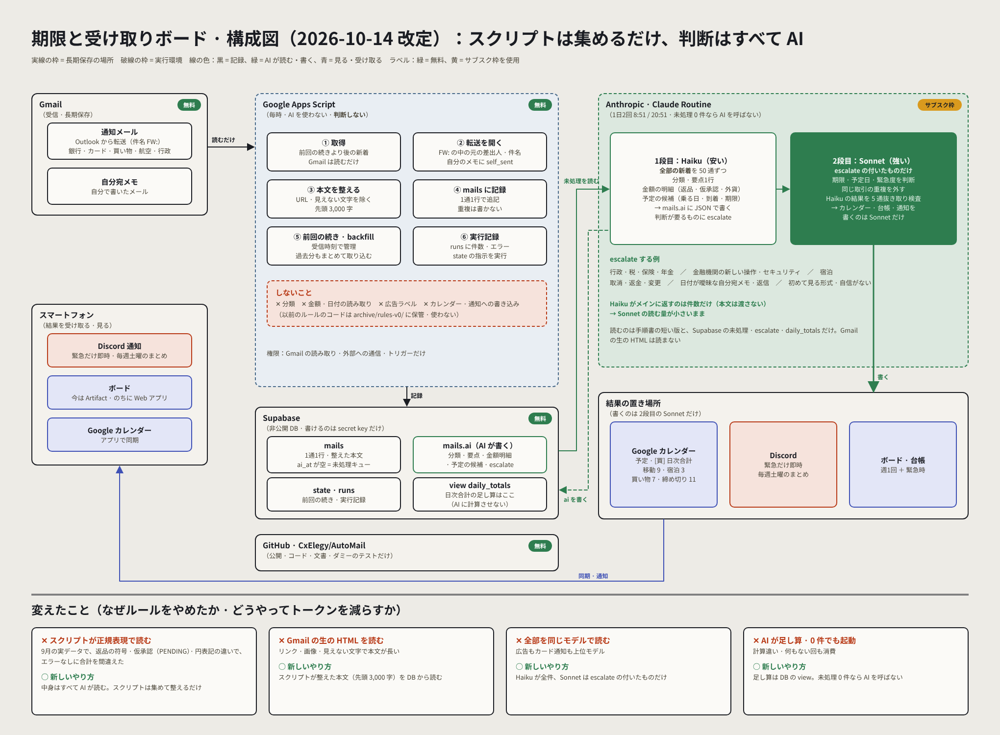

# AutoMail — 期限と受け取りボード

Gmail に届くメールから「期限」「受け取り」「移動・宿泊」「支払い」に関わる情報を毎日自動で拾い出し、1枚の Web ページ（ボード）と Google カレンダーにまとめ続ける、Claude による自動運転システムです。

もともと Google Drive のフォルダ「期限と受け取りボード」で運用していた仕様書・手順書を、このリポジトリに移したものです。

> **注意：このリポジトリは public です。** メールアドレス・注文番号・予約番号・人名・Drive のファイル ID などの個人情報は書かないでください。実際の値は `config/config.example.md` を参考に、リポジトリの外（Scheduled task の prompt や Drive 上の台帳）で管理します。



移行中の新しい構成（2026-10-14 改定）。計画は [`docs/automation-plan.md`](docs/automation-plan.md)。

## 全体像（どこに何があるか）

| 場所 | 役割 |
|---|---|
| **Scheduled task（Routine）**「期限と受け取りボード」 | 毎日 8:51／20:51 JST に起動する処理の入口。prompt の雛形は [`prompts/scheduled-task.md`](prompts/scheduled-task.md) |
| **このリポジトリ** | 仕様・運用ルールを伏せ字にした写しと構成図。[`docs/update-procedure.md`](docs/update-procedure.md) に詳細ルールを蓄積 |
| Google Drive `00_更新手順`・`00a_省トークン運転ルール` | Routine が実際に毎回読む手順書。直したらこのリポジトリにも反映する |
| Google Drive `01_記録台帳 YYYY-MM` | 現在の状態のスナップショット（最後に読んだメールの受信時刻・カレンダー登録済みイベントID・未確認事項）。**月に1ファイル** |
| Google Drive `02_メールDB（1件1ブリーフィング）` | 読んだメール全件の生記録。**日に1ファイル**、1メール＝1ブロック。広告・求人も含めすべて残す |
| Artifact「期限と受け取りボード」 | 人間が実際に見る成果物。カレンダー・今日やること・受け取り待ち・期限一覧・ログイン通知をまとめた1枚の Web ページ。更新は週1回（土曜 20:51）＋緊急時だけ |
| Google カレンダー（primary） | 移動・宿泊・買い物（日次合計）・重要締め切りをイベントとして登録する場所 |
| スマートフォン（プッシュ通知・.ics） | 緊急の事案だけプッシュ通知。予定を新しく作った回は .ics を再発行 |

構成図は [`design/Architecture.dc.html`](design/Architecture.dc.html)（Claude Design のキャンバス。`canvas.json` と一緒に読み込む）。

## 処理の流れ・ルール

毎回の処理手順、色分け、カレンダー登録ルール、既知のリスクはすべて [`docs/update-procedure.md`](docs/update-procedure.md) に一本化しています（ここに要約を置くと更新漏れで食い違うため、複製しません）。定期実行の起動条件と軽量運転のルールは [`prompts/scheduled-task.md`](prompts/scheduled-task.md) にあります。

## ディレクトリ構成

```
.
├── README.md                    # このファイル（システム概要）
├── CLAUDE.md                    # このリポジトリで作業する Claude 向けの指示
├── apps-script/                 # 省トークン自動化のスクリプト（Gmail を集めて Supabase に記録するだけ。判断は AI）。設定手順は中の README
├── archive/rules-v0/            # 使わなくなった「ルールで分類・読み取り」のコード（記録用）
├── db/
│   └── automail.sql             # Supabase のテーブル定義
├── design/
│   ├── Architecture.dc.html     # 構成図（Claude Design のキャンバス）
│   ├── Automation.dc.html       # 省トークン自動化の構成図（案）
│   └── canvas.json              # 同キャンバスの設定
├── docs/
│   ├── automation-plan.md       # 省トークン自動化の計画（案）
│   ├── design/automation.png    # 同 構成図の画像
│   └── update-procedure.md      # 詳細ルール（「00_更新手順」＋「00a」7〜9節の写し）
├── prompts/
│   └── scheduled-task.md        # Scheduled task の prompt 雛形・軽量／省トークン運転ルール（「00a」1〜6節）
├── tests/                       # run()・backfill() のテスト（ダミーデータのみ。node --test tests/*.test.js）
├── tools/gas-push.mjs           # Apps Script API でコードを反映する（任意）
└── config/
    └── config.example.md        # 実運用で使う ID・アドレスの置き場所（値は書かない）
```

## 今後の予定

- [ ] 省トークン自動化への移行（スクリプトは集めるだけ、判断は AI が Haiku → Sonnet の2段で）：[`docs/automation-plan.md`](docs/automation-plan.md)、構成図 [`docs/design/automation.png`](docs/design/automation.png)。台帳とメールDBの Supabase 移行もここに含む
- [ ] 1日の流れ（タイムライン）の図を作る

## 変更履歴

- **2026-09-10**：全件精読による初期構築。
- **2026-09-11**：カレンダーの凡例・日またぎ連結線を追加。非重要締め切り（ce-minor）を新設。
- **2026-09-12**：カレンダー書き漏れ再発防止の6ステップ手順を確立。カレンダー件名の命名規則を改定。
- **2026-09-14**：「到着」カテゴリを「買い物」から分離。処理上限を100→200件、更新頻度を1日8回に。
- **2026-09-15**：台帳は月1ファイル、メールDBは日1ファイルに統一。
- **2026-09-22**：ログイン通知タブ新設。自分宛メモを重要イベント扱いに。Web版カレンダーを JS の汎用描画（月の上限なし）に刷新。祝日・土日の塗り分けを追加。
- **2026-09-23**：Google Drive から GitHub リポジトリ（本リポジトリ）へ移行。
- **2026-09-24**：英検S-CBT受験日（申込日とは別の日）のカレンダー登録漏れを修正。「申込日と実施日を両方登録する」ルールと、「.icsは create_event を1件でも呼んだら無条件で再発行する」機械的な基準を追加。
- **2026-09-27**：ponytail（YAGNI・重複排除）の観点で整理。ボードの未使用CSS/JSを削除し、絞り込みの説明文が出ない不具合（未定義変数 `adN`）を修正。README とルール文書の重複記述を削り、正本を1か所に。
- **2026-10-12**：Drive 版の手順書（00・00a）に同期。起動を1日2回（8:51／20:51）に、ボード更新を週1回＋緊急時に変更したことを反映。買い物の日次合計・カレンダー件名の `[ ]` 形式・金融機関／行政事案の緊急扱いを追記。構成図（`design/`）を追加。
- **2026-10-14**：省トークン自動化の段階1（Apps Script で Gmail を取得・分類して Supabase に記録）を追加。DB は Wishlist と別の Supabase プロジェクト、通知は Discord、カレンダーはスマホで直接同期と決定。
- **2026-10-14（改定）**：スクリプトはルールで判断しない方針に変更。Apps Script は取得・整形・記録だけにし、分類・金額・予定の読み取りは AI（安いモデル → 判断が要るものだけ上位モデル）に任せる。広告ラベル `automail-skip` は廃止。
